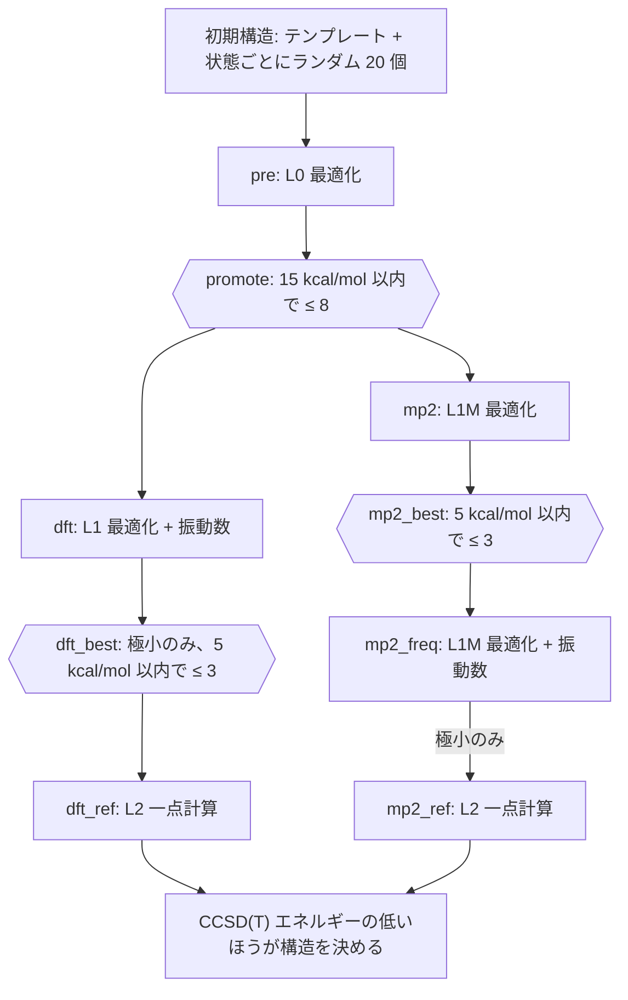

# 手法のはしご

!!! info "前提知識"
    [DFT](../methods/dft.md)、[MP2](../methods/mp2.md)、[結合クラスター法](../methods/coupled-cluster.md)

すべての候補構造に使えるほど安く、かつ最終的な答えに使えるほど精密な手法はひとつもない。**手法のはしご**は複数の手法を使う。すべてに安価な手法を、生き残ったものによりよい手法を、重要な少数の構造に最良の手法を。各段が次の段のためにふるいにかける。はしごには評価の仕組みも組み込まれている。高価な段が、安価な段がどれだけ間違っていたかを測る。

## 考え方

### コスト対精度

このプロジェクトで [H₁₀](app:s/10/0/1) の構造 1 つを 1 コアで計算するコスト (試験計算、`doc/Plan.md` フェーズ 4):

| 段 | 手法 | 時間 | 用途 |
|---|---|---|---|
| L0 | r²SCAN-3c | 勾配 1 回 3〜15 秒 | すべての候補の予備最適化 |
| L1 | ωB97X-D4/def2-TZVPPD | 最適化 + 解析的振動数で 16 分 | DFT 構造 + 振動数 |
| L1M | RI-MP2/aug-cc-pVTZ | 勾配 1 回 38 秒。数値的振動数は数時間 | 2 つ目の構造レベル |
| L2 | CCSD(T)/aug-cc-pVTZ | 一点計算 1 回 13 分、ディスク 12 GB | 参照エネルギー |

約 1300 個の出発構造すべてに CCSD(T) を使うのは不可能だが、最終的な 50 構造ならたやすい。

### 危険: 間違った答えでふるいにかける

はしごがうまくいくのは、各段が、次の段が最もよいと順位づけるはずの構造を残すときだけである。安価な手法の順位づけが悪ければ、精密な手法が目にする前に正しい答えが捨てられてしまう。防御策:

- 安価な段では**幅を広くとる**: 最も低い構造だけでなく、15 kcal/mol 以内のものをすべて昇格させる。
- 安価な段が同じ死角を共有しているときは**独立した 2 つの分岐**をもつ。
- 失敗すると分かっているときは、**最も安い段のエネルギーをまったく信用しない**: xTB は構造を提案するだけである ([xTB](../methods/xtb.md))。
- **順序を確かめる**: L0 と L1 が構造を同じように順位づけるかの整合性チェックで、問題にフラグを立てる (`doc/Plan.md` §6)。

## このプロジェクトのやり方

(`campaigns/baseline.yaml`。六角形は[選抜バリア](selection-barriers.md)。)

はしごは証拠に基づいて 2 度設計し直された:

- [H₃⁺](app:s/3/1/1) の順位づけを誤ったあと、**xTB は構造の提案役に格下げ**された (フェーズ 0)。
- どの DFT レベルも [H₅⁺](app:s/5/1/1) の C₂ᵥ 構造を D₂d に変えてしまったあと、**2 つ目の構造分岐 (MP2)** が加わった (フェーズ 3)。2 つの分岐は違う死角をもち (DFT には [自己相互作用](../pitfalls/self-interaction-error.md)、MP2 には基底への敏感さ)、両方に対する CCSD(T) が決着をつける。
- 試験計算のあと、**段が安くなった**: ωB97M-V → ωB97X-D4 (解析的ヘッセ行列)、従来の MP2 → RI-MP2、MP2 の振動数は上位 3 つだけ (フェーズ 4)。見積もりは約 800 から約 120 CPU 時間に下がった。

### 評価としてのはしご

最終的な構造はどれもすべての段でのエネルギーをもつので、キャンペーンは同じ構造で各手法の CCSD(T) に対する誤差を測ることになる。ウェブアプリの[ベンチマーク](app:benchmark)ページがそれである (`doc/Plan.md` §4)。このウィキにすでにある例: [H の電子親和力](../techniques/ionization-and-electron-affinity.md#examples-from-the-campaign)の 4 つのレベルでの値、[DFT での H₂⁺](../pitfalls/self-interaction-error.md#examples-from-this-project)。

## [h_clusters](https://github.com/skachano/h_clusters) での登場箇所 { #where-this-appears-in-h_clusters }

- `worker/src/hclust/levels.py` の `LEVELS`: 手法、基底、微分の対応、スクラッチの見積もりをもつ各段。
- `campaigns/baseline.yaml` の `stages:`: このキャンペーンのはしご。
- `doc/Plan.md` §2: 手法のはしごの表とその根拠。
- [ウェブアプリ](app:): [「手法比較」](app:benchmark)ページで各段の $D_e$ が CCSD(T) からどれだけ離れているかを、[「ジョブ」](app:jobs)ページでステージを示す。

## 参考文献

- `doc/Plan.md` §2 とフェーズ 0〜4 の知見。
- M. Bursch, J.-M. Mewes, A. Hansen, S. Grimme, *Angew. Chem. Int. Ed.* **61**, e202205735 (2022): 多段階のワークフローを含む、DFT のベストプラクティス。
