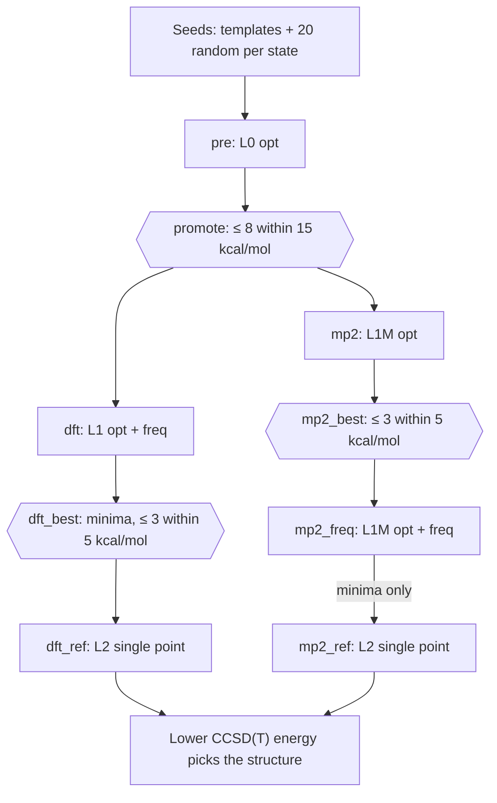

# Method ladders

!!! info "Prerequisites"
    [DFT](../methods/dft.md), [MP2](../methods/mp2.md), [Coupled cluster](../methods/coupled-cluster.md)

No single method is both cheap enough for every candidate structure and
accurate enough for final answers. A **method ladder** uses several: a cheap
method on everything, better methods on what survives, the best method on
the few structures that matter. Each rung filters for the next. The ladder
also gives a built-in benchmark: the expensive rungs measure how wrong the
cheap ones were.

## Idea

### Cost against accuracy

Costs in this project for one [H₁₀](app:s/10/0/1) structure on one core (pilot, `doc/Plan.md`
Phase 4):

| Rung | Method | Time | Use |
|---|---|---|---|
| L0 | r²SCAN-3c | 3–15 s per gradient | pre-optimize every candidate |
| L1 | ωB97X-D4/def2-TZVPPD | 16 min opt + analytic freq | DFT geometry + frequencies |
| L1M | RI-MP2/aug-cc-pVTZ | 38 s per gradient; hours for numerical freq | second geometry level |
| L2 | CCSD(T)/aug-cc-pVTZ | 13 min, 12 GB disk, per single point | reference energies |

CCSD(T) for all ~1300 starting structures would be impossible; on 50 final
structures it is easy.

### The danger: filtering on the wrong answer

A ladder only works if each rung keeps the structures that the next rung
would rank best. If a cheap method ranks badly, the right answer is thrown
away before an accurate method ever sees it. Defences:

- **Generous windows** at cheap rungs: promote everything within 15 kcal/mol,
  not just the lowest structure.
- **Two independent branches** when the cheap rungs share a blind spot.
- **Don't trust the cheapest rung's energies at all** when it is known to fail:
  xTB only proposes geometries ([xTB](../methods/xtb.md)).
- **Check the ordering**: a consistency check that L0 and L1 rank structures
  the same way flags trouble (`doc/Plan.md` §6).

## How this project does it

(`campaigns/baseline.yaml`; hexagons are [selection barriers](selection-barriers.md).)

The ladder was redesigned twice by evidence:

- **xTB demoted** to geometry proposer after it ranked [H₃⁺](app:s/3/1/1) wrongly (Phase 0).
- **A second geometry branch (MP2)** after every DFT level turned [H₅⁺](app:s/5/1/1)'s C₂ᵥ
  structure into D₂d (Phase 3). The two branches have different blind
  spots ([self-interaction](../pitfalls/self-interaction-error.md) for DFT,
  basis-set sensitivity for MP2), and CCSD(T) on both decides.
- **Cheaper rungs** after the pilot: ωB97M-V → ωB97X-D4 (analytic Hessian),
  conventional MP2 → RI-MP2, MP2 frequencies only for the best 3 (Phase 4).
  The estimate fell from ~800 to ~120 CPU-hours.

### The ladder as a benchmark

Because every final structure has energies at every rung, the campaign
measures each method's error against CCSD(T) on the same structures: the
[Benchmark](app:benchmark) page of the web app (`doc/Plan.md` §4). Examples
already in this wiki: the [electron affinity of H](../techniques/ionization-and-electron-affinity.md#examples-from-the-campaign)
at four levels and [H₂⁺ under DFT](../pitfalls/self-interaction-error.md#examples-from-this-project).

## Where this appears in [h_clusters](https://github.com/skachano/h_clusters)

- `LEVELS` in `worker/src/hclust/levels.py`: every rung with its method, basis,
  derivative support and scratch estimate.
- `stages:` in `campaigns/baseline.yaml`: the ladder for this campaign.
- `doc/Plan.md` §2: the method ladder table and its rationale.
- [Web app](app:): the [Benchmark](app:benchmark) page shows how far each rung's
  $D_e$ is from CCSD(T); the [Jobs](app:jobs) page shows the stages.

## References

- `doc/Plan.md` §2 and Phase 0–4 findings.
- M. Bursch, J.-M. Mewes, A. Hansen, S. Grimme, *Angew. Chem. Int. Ed.* **61**,
  e202205735 (2022): best-practice DFT protocols, including multilevel workflows.
