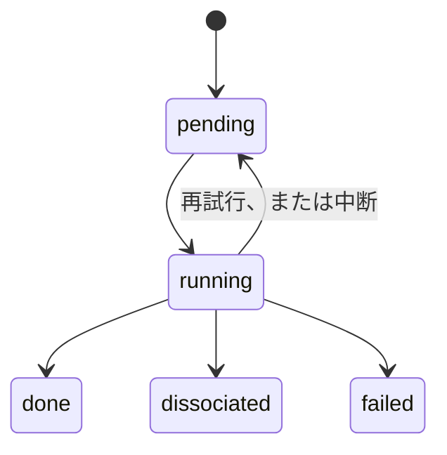

# 来歴管理と再開可能性

!!! info "前提知識"
    [ジョブのハッシュ化](job-hashing.md)

何時間にもわたる千個のジョブのキャンペーンは、必ず中断される。クラッシュ、ディスクの満杯、修正すべきバグ、再起動すべきマシン。**再開可能性**とは、再開したとき止まったところから続き、完了した作業をやり直さず、実行中の作業を失わないことである。**来歴** (provenance) とは、どの数値もそれがどうつくられたかまでたどれることである。どちらも同じ習慣から生まれる。すべての状態変化をデータベースに記録し、生の出力を真実の源として残すことである。

## 考え方

### データベースはキャッシュではなく台帳

すべてのジョブには、小さな状態機械の上を動く状態がある:

それぞれの遷移は、起きた瞬間にデータベースへコミットされる。オーケストレーターが死んでも、データベースには何が完了し、何が実行中で、何が待っていたかが正確に残っている。再開すると:

1. `running` とされたジョブは、もう存在しないプロセスのものである: `pending` に戻す。
2. キャンペーンを計画し直す: 計画は冪等なので、既存のジョブは重複せずに再び見つかる。
3. 待機中のジョブを実行する: 結果がすでにディスクにあるものは [キャッシュヒット](job-hashing.md)になる。

### 生の出力を残す

データベースは生のファイルの*索引*であり、唯一のコピーであってはならない。あとでパーサーのバグが見つかっても、何も再実行せずに元の出力から結果を取り出し直せる。

### すべての試行を記録する

ジョブは何度も実行されることがある (再試行、再開)。各**試行**を、その入力、結果、エラー、経過時間とともに記録すれば、「このジョブはなぜ 3 回も必要だったのか」といった問いに答えられ、キャンペーン全体での失敗のパターンが見えるようになる。

## このプロジェクトのやり方

**状態。** `data/hclust.sqlite` の SQLite (WAL モード) で、テーブルは `state`、`structure`、`job`、`attempt`、`result`、`candidate` (`worker/src/hclust/db.py`、`doc/Plan.md` §3.4)。データベースを所有するのはオーケストレーターのプロセス 1 つだけなので、書き込みの競合は起きない。ワーカースレッドは ORCA のプロセスを待つだけである。

**来歴の連鎖。**すべての `structure` 行は、その `origin` (初期構造生成器か、それをつくったステージと操作) と `parent_job_id` を記録している。すべての `job` は、その入力構造、開始構造、親ジョブを記録している。したがってどの最終構造も、各最適化、再開、ずらしを通って、元の初期構造までたどれる。

**生のファイル。** `data/jobs/<hash>/` には `job.inp`、`job.out`、`job.property.json` などの小さな出力が残り、スクラッチファイルは削除される (`engines/orca.py` の `KEEP_SUFFIXES`)。

**中断。** Ctrl-C (または `docker stop`) で、`kill_all()` がすべての ORCA のプロセスグループを停止し、実行中のジョブは `pending` に戻る。その機会なしにオーケストレーターが停止させられた場合は `Runner._recover()` が処理する。

**仮定ではなく試験済み。**フェーズ 2 の受け入れ試験: 実行の途中でキャンペーンを中断し、再実行では中断されたジョブとその子だけが実行され、3 回目の実行では何も実行されないこと。試験は合格し、ランナーのテストは台本どおりに動く偽の ORCA を使って、中断、再開、クラッシュからの回復を確かめている (`worker/tests/test_runner.py`)。

**修復は手作業の編集ではなくコマンドで。**

| コマンド | 内容 |
|---|---|
| `python -m hclust run <campaign.yaml>` | (冪等に) 計画し、待機中のものをすべて実行する |
| `python -m hclust status <campaign>` | 状態 × ステージのジョブ数の表 |
| `python -m hclust retry-failed <campaign> [--stage] [--reopen]` | 失敗したジョブ (`--reopen` なら誤って解離とされたものも) に新しい試行を与える |
| `python -m hclust reselect <campaign>` | 選抜の記録を消してやり直させる |
| `python -m hclust structures <campaign> --stage <name>` | 候補とその行く末を一覧する |

フェーズ 4 では、最初の一巡のあとで解離カットオフが誤っていたことが分かった。修復は `reselect` (選抜記録 1,232 件の消去) と `retry-failed --reopen` (267 ジョブの再投入) のあと再起動するだけで、完了した計算はすべて残った。

## h_clusters での登場箇所

- `worker/src/hclust/runner.py` の `Runner.run`、`_recover`、`_requeue`、`requeue_failed`。コマンドは `worker/src/hclust/cli.py` にある。
- `attempt` テーブル: ベースラインではこれまでに 2,274 回の試行が記録され、操作は `restart` (372)、`displace` (71)、`scf` (1) である。

## 参考文献

- `doc/Plan.md` §3.4–3.5 とフェーズ 2 の知見。
- 比較として、同じ目標をもつワークフローフレームワーク: AiiDA (完全な来歴グラフ)、jobflow/quacc、FireWorks。計画のフェーズ 8 には、ランナーをそれらのひとつに移植することが含まれる。
