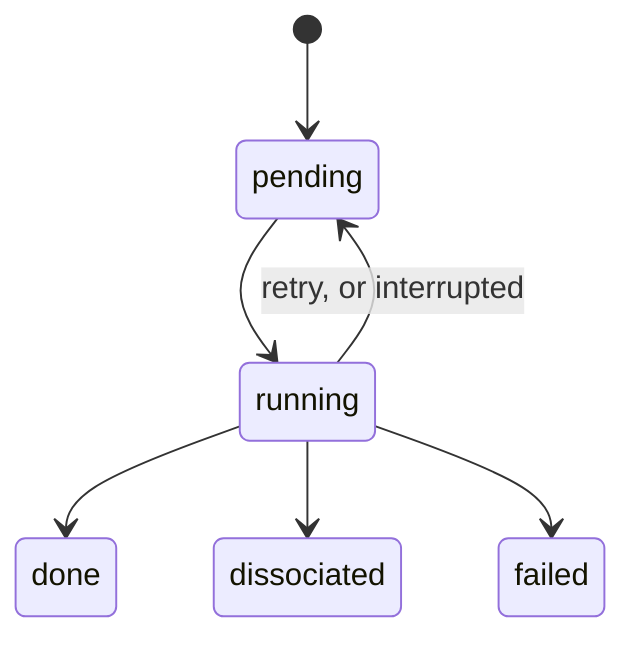

# Provenance and resumability

!!! info "Prerequisites"
    [Job hashing](job-hashing.md)

A campaign of a thousand jobs over many hours will be interrupted: a crash,
a full disk, a bug to fix, a machine to reboot. **Resumability** means
restarting picks up where it stopped, without redoing finished work or
losing running work. **Provenance** means every number can be traced back
to how it was made. Both come from the same habit: record every state change
in a database, and keep raw outputs as the source of truth.

## Idea

### The database is a ledger, not a cache

Every job has a status that moves through a small state machine:

Each transition is committed to the database the moment it happens. If the
orchestrator dies, the database still says exactly what was finished, what
was running, and what was waiting. On restart:

1. Jobs marked `running` belong to a process that no longer exists: put them
   back to `pending`.
2. Re-plan the campaign: planning is idempotent, so existing jobs are found
   again rather than duplicated.
3. Run the pending jobs. Any whose result is already on disk are
   [cache hits](job-hashing.md).

### Keep the raw outputs

The database is an *index* over the raw files, never the only copy. If a
parser bug is found later, results can be re-extracted from the original
outputs without rerunning anything.

### Record every attempt

A job may run several times (retries, restarts). Recording each **attempt**
with its own inputs, outcome, error and wall time answers questions like "why
did this job need three tries?" and makes failure patterns visible across a
campaign.

## How this project does it

**State.** SQLite at `data/hclust.sqlite` (WAL mode), with tables `state`,
`structure`, `job`, `attempt`, `result` and `candidate`
(`worker/src/hclust/db.py`; `doc/Plan.md` §3.4). A single orchestrator process
owns the database, so there are no write races; worker threads only wait for
ORCA processes.

**Provenance chain.** Every `structure` row records its `origin` (a seed
generator, or the stage and action that produced it) and its `parent_job_id`.
Every `job` records its input and start structures and parent job. So any
final geometry can be followed back through each optimization, restart and
displacement to the seed it came from.

**Raw files.** `data/jobs/<hash>/` keeps `job.inp`, `job.out`, `job.property.json`
and the other small outputs; scratch files are deleted (`KEEP_SUFFIXES` in
`engines/orca.py`).

**Interrupts.** On Ctrl-C (or `docker stop`), `kill_all()` kills every ORCA
process group, and running jobs go back to `pending`. `Runner._recover()`
handles the case where the orchestrator was killed without that chance.

**Tested, not assumed.** Phase 2's acceptance test: interrupt a campaign
mid-run; the rerun must execute only the interrupted job and its children,
and a third run must execute nothing. It passed, and the runner's tests use
a scripted fake ORCA to check interrupt, resume and crash recovery
(`worker/tests/test_runner.py`).

**Repairs are commands, not hand edits.**

| Command | What it does |
|---|---|
| `python -m hclust run <campaign.yaml>` | Plan (idempotently) and run everything pending |
| `python -m hclust status <campaign>` | States × stages table of job counts |
| `python -m hclust retry-failed <campaign> [--stage] [--reopen]` | Fresh attempts for failed jobs (and, with `--reopen`, wrongly dissociated ones) |
| `python -m hclust reselect <campaign>` | Clear selection records so they are redone |
| `python -m hclust structures <campaign> --stage <name>` | List candidates and their fate |

In Phase 4, the dissociation cutoff turned out to be wrong after the first
pass. The repair was `reselect` (clearing 1,232 selection records) and
`retry-failed --reopen` (requeueing 267 jobs), then a relaunch, with every
completed calculation kept.

## Where this appears in h_clusters

- `Runner.run`, `_recover`, `_requeue` and `requeue_failed` in
  `worker/src/hclust/runner.py`; the commands in `worker/src/hclust/cli.py`.
- The `attempt` table: 2,274 attempts recorded in the baseline so far, with
  actions `restart` (372), `displace` (71) and `scf` (1).
- Web app: the [Jobs](app:jobs) page lists the failed jobs with their
  attempts.

## References

- `doc/Plan.md` §3.4–3.5 and Phase 2 findings.
- For comparison, workflow frameworks with the same goals: AiiDA (full
  provenance graphs), jobflow/quacc, FireWorks. The plan's Phase 8 includes
  porting the runner to one of them.
