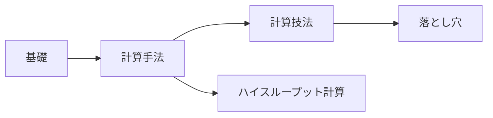

# H-Clusters ウィキ

このプロジェクトの背後にある量子化学の解説である。計算が何を求めているのか、手法がどのように動くのか、そしてどこで破綻するのかを扱う。どのページも h_clusters のパイプラインが実際に行っていることに結びつけてあるので、概念を実際の結果と照らし合わせて確かめられる。

結果そのものは[ウェブアプリ](app:)にある。すべての化学種 H_m^n について、構造、解離チャネル、安定性を見られる。このウィキのページに出てくる化学種は、[H₅⁺](app:s/5/1/1) のようにアプリのそのページへリンクしている。アプリからも、使っている用語からこのウィキへリンクしている。

## セクション

| セクション | 内容 |
|---|---|
| [基礎](foundations/index.md) | 他のすべての土台となる物理: シュレーディンガー方程式、ボルン–オッペンハイマー近似、ポテンシャルエネルギー曲面、スピン |
| [計算手法](methods/index.md) | エネルギーの計算方法: ハートリー–フォック法、DFT、MP2、結合クラスター法、xTB、基底関数系 |
| [計算技法](techniques/index.md) | 得られたエネルギーの使い方: 構造最適化、振動数、熱化学、構造探索 |
| [落とし穴](pitfalls/index.md) | よく知られた失敗のしかたと、それを示すこのプロジェクトの例 |
| [ハイスループット計算](htc/index.md) | 何千ものジョブを再現性を保って実行する方法: ハッシュ化、来歴管理、手法のはしご |

## おすすめの読む順序

## 参考文献

各ページは次の標準的な教科書を引用している:

- A. Szabo, N. S. Ostlund, *Modern Quantum Chemistry* (Dover, 1996) (邦訳: 『新しい量子化学』東京大学出版会)
- F. Jensen, *Introduction to Computational Chemistry*, 3rd ed. (Wiley, 2017)
- C. J. Cramer, *Essentials of Computational Chemistry*, 2nd ed. (Wiley, 2004)
- ORCA 6 マニュアル

!!! note "翻訳について"
    このウィキの原文は英語である。図の中の文字やプログラムの出力は英語のままにしてある。用語の訳が分かりにくいときは、右上の言語切り替えで同じページの英語版を開ける。
