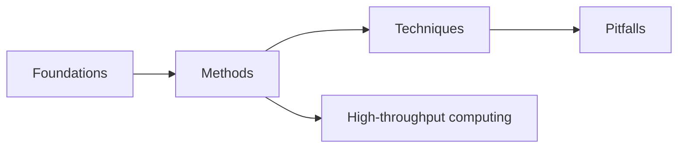

# H-Clusters Wiki

Explanations of the quantum chemistry behind this project: what the
calculations compute, how the methods work, and where they fail. Every page
ties back to something the h_clusters pipeline actually does, so concepts can
be checked against real results.

## Sections

| Section | Covers |
|---|---|
| [Foundations](foundations/index.md) | The physics the rest builds on: Schrödinger equation, Born–Oppenheimer, potential energy surfaces, spin |
| [Methods](methods/index.md) | How energies are computed: Hartree–Fock, DFT, MP2, coupled cluster, xTB, basis sets |
| [Techniques](techniques/index.md) | What is done with those energies: optimization, frequencies, thermochemistry, structure search |
| [Pitfalls](pitfalls/index.md) | Known failure modes, each with an example from this project |
| [High-throughput computing](htc/index.md) | Running thousands of jobs reproducibly: hashing, provenance, method ladders |

## Suggested reading order

## References

Pages cite these standard texts:

- A. Szabo, N. S. Ostlund, *Modern Quantum Chemistry* (Dover, 1996)
- F. Jensen, *Introduction to Computational Chemistry*, 3rd ed. (Wiley, 2017)
- C. J. Cramer, *Essentials of Computational Chemistry*, 2nd ed. (Wiley, 2004)
- The ORCA 6 manual
