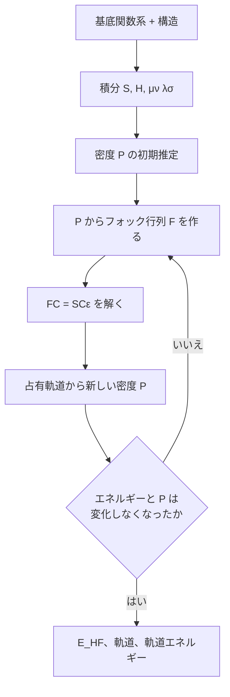

# ハートリー–フォック法

!!! info "前提知識"
    [ポテンシャルエネルギー曲面](../foundations/potential-energy-surface.md)

ハートリー–フォック (HF) 法は、分子の電子を第一原理から計算する最も単純な方法である。近似はひとつだけで、各電子は他のすべての電子がその瞬間に実際にどこにいるかに反応するのではなく、それらがつくる*平均的な*場の中を動くと考える。これで問題が解けるようになる。HF は全エネルギーの大部分を再現し (H₂ で 96.5 %、重い原子を含む分子では 99 % 以上)、このプロジェクトのより精密な手法 (MP2、結合クラスター法) の出発点になる。DFT も同じ仕組みを使っている。

## 考え方

### HF が解く問題

原子核を固定したときの電子ハミルトニアン (原子単位) は

$$
\hat{H} = \underbrace{-\frac{1}{2}\sum_i \nabla_i^2}_\text{運動エネルギー}
\;\underbrace{-\sum_i\sum_A \frac{Z_A}{r_{iA}}}_\text{原子核への引力}
\;+\underbrace{\sum_{i<j} \frac{1}{r_{ij}}}_\text{電子間反発}
$$

最初の 2 項は一度に 1 個の電子にだけ作用し、合わせて**一電子演算子** $h$ となる。最後の項はすべての電子の対を結びつける。一電子系より大きいものについてシュレーディンガー方程式 $\hat{H}\Psi = E\Psi$ が厳密に解けないのは、この項のためである。

### ステップ 1: 電子 1 個に軌道 1 つ { #step-1-one-orbital-per-electron }

HF は、波動関数が電子 1 個につき 1 つの**軌道**からできていると仮定する。軌道は**スレーター行列式**として組み合わされ、2 つの電子を入れ替えると波動関数の符号が変わるようになっている。電子 (フェルミ粒子) はそう振る舞わなければならず、これによってパウリの原理が自動的に満たされる。スピン軌道 $\chi_1$ と $\chi_2$ にある 2 電子の場合:

$$
\Psi(1,2) = \frac{1}{\sqrt{2}}\Big[\chi_1(1)\,\chi_2(2) - \chi_2(1)\,\chi_1(2)\Big]
$$

**制限** HF (RHF) では電子は対をつくり、各空間軌道に上向き (α) と下向き (β) の電子が 1 個ずつ入る。H₂ の基底状態は、1 つの軌道 $\sigma_g$ に 2 個の電子が入ったものである。

### ステップ 2: 平均場 { #step-2-the-mean-field }

スレーター行列式のエネルギーを最小にすると、各軌道について**フォック演算子** $f$ を含む有効一電子方程式が得られる:

$$
f\,\psi_i = \varepsilon_i\,\psi_i, \qquad
f = h + \sum_{j}^\text{occ} \big(2J_j - K_j\big)
$$

- $J_j$ (**クーロン**): 軌道 $j$ の電子の電荷雲から受ける古典的な反発。
- $K_j$ (**交換**): 古典的な対応物のない補正で、行列式の反対称性から生じる。行列式が同じスピンの電子を互いに遠ざけるので、それらの間の反発を下げる。
- $\varepsilon_i$: **軌道エネルギー**。占有軌道では、$-\varepsilon_i$ がおおよそその電子を取り去るのに必要なエネルギーになる (クープマンスの定理)。

問題は、$f$ が $J$ と $K$ を通じて軌道に依存し、その軌道は $f$ から得られることである。HF は、出てくる軌道が入れた軌道と一致するまで反復して解く。これが**自己無撞着場** (SCF) である。

!!! note "自己相互作用がない"
    HF のエネルギーでは、電子が自分自身の電荷雲から受けるクーロン反発は、自分自身の交換項によってちょうど打ち消される。DFT にはこの厳密な打ち消しがなく、残った**自己相互作用誤差**のために DFT は H₂⁺ を大きく間違える (`doc/Plan.md` §1.2)。一電子系では HF に近似するものが何もないので、基底関数系の範囲で厳密である。

### ステップ 3: 基底関数で展開する

軌道は 3 次元空間の未知の関数である。計算できるようにするため、各軌道を $N$ 個の決まった**基底関数** $\phi_\mu$ (普通は原子を中心とするガウス関数) の線形結合として書く:

$$
\psi_i = \sum_{\mu=1}^{N} C_{\mu i}\,\phi_\mu
$$

フォック方程式は行列方程式、**ローターン–ホール方程式**になる:

$$
\mathbf{F}\mathbf{C} = \mathbf{S}\mathbf{C}\boldsymbol{\varepsilon}
$$

ここで $S_{\mu\nu} = \langle\phi_\mu|\phi_\nu\rangle$ は基底関数の重なり (基底関数は直交していない) であり、フォック行列は**密度行列** $\mathbf{P}$ から組み立てられる:

$$
F_{\mu\nu} = H_{\mu\nu} + \sum_{\lambda\sigma} P_{\lambda\sigma}
\Big[(\mu\nu|\sigma\lambda) - \tfrac{1}{2}(\mu\lambda|\sigma\nu)\Big],
\qquad
P_{\lambda\sigma} = 2\sum_a^\text{occ} C_{\lambda a} C_{\sigma a}
$$

$H_{\mu\nu}$ は一電子積分 (運動エネルギーと原子核への引力) である。$(\mu\nu|\lambda\sigma)$ は**二電子積分**で、電荷分布 $\phi_\mu\phi_\nu$ と $\phi_\lambda\phi_\sigma$ の間の反発である。互いに異なるものが約 $N^4/8$ 個あり、その計算がコストを支配するので、コストは $N^4$ で増える。

収束したときのエネルギーは

$$
E_\text{HF} = \frac{1}{2}\sum_{\mu\nu} P_{\nu\mu}\big(H_{\mu\nu} + F_{\mu\nu}\big) + V_{NN}
$$

で、$V_{NN}$ は原子核間の反発である。

### SCF ループ { #the-scf-loop }



$\mathbf{FC} = \mathbf{SC}\boldsymbol{\varepsilon}$ は、基底を変換すれば普通の固有値問題になる。$\mathbf{X} = \mathbf{S}^{-1/2}$ として $\mathbf{X}^\mathsf{T}\mathbf{F}\mathbf{X}$ を対角化し、固有ベクトルを $\mathbf{C} = \mathbf{X}\mathbf{C}'$ で元に戻せばよい。

## 例: H₂ を一から計算する { #example-h2-from-scratch }

`wiki/examples/h2_minimal_basis.py` は、以上のすべてを numpy で実装している。対象は STO-3G 基底の H₂ で、各原子に 1s 型の関数が 1 つずつあり、それぞれが 3 つのガウス関数の和である。中心は SCF ループである:

```python
--8<-- "h2_minimal_basis.py:rhf"
```

実験の結合長 R = 1.4 bohr での出力:

```text
H2 / STO-3G at R = 1.4 bohr (0.741 Å)

overlap S12 = 0.6593
  iter  1  E_elec = 0.0000000000
  iter  2  E_elec = -1.8309999891
  iter  3  E_elec = -1.8309999891

orbital energies   -0.5782 (sigma_g, occupied)  0.6703 (sigma_u, empty)
nuclear repulsion  0.7143
E(RHF)             -1.1167
E(FCI)             -1.1373
correlation energy -0.0206  (-0.56 eV)
```

これらは Szabo & Ostlund §3.5 の値と一致する。出力の読み方:

- **重なり 0.66。**この距離では 2 つの原子の関数が大きく重なっている。この共有された領域が化学結合である。
- **すぐに収束する。**反復 1 は空の密度から始まるので、そのエネルギーには意味がない。反復 3 は反復 2 を繰り返しているだけである。基底関数が 2 つしかないと、対称性だけで軌道が決まる: $\sigma_g \propto \phi_A + \phi_B$ (結合性) と $\sigma_u \propto \phi_A - \phi_B$ (反結合性)。大きな問題ではもっと多くの反復が必要になる (下の ORCA の実行を参照)。
- **軌道エネルギー。** $-\varepsilon_{\sigma_g}$ = 0.578 ハートリー = 15.7 eV で、H₂ のイオン化エネルギーの測定値 (15.4 eV) に近い。
- **全エネルギー** = 電子エネルギー + 原子核間反発 = −1.8310 + 0.7143。

### ORCA での同じ計算 { #the-same-thing-in-orca }

このプロジェクトの実際のジョブ (三重項の H₃⁺、aug-cc-pVTZ で基底関数 69 個、UHF) に対する ORCA の出力:

```text
               *           SCF CONVERGED AFTER  10 CYCLES          *
TOTAL SCF ENERGY
Total Energy       :         -1.11272506468041 Eh             -30.27879 eV
Components:
Nuclear Repulsion  :          1.01846206783759 Eh              27.71376 eV
Electronic Energy  :         -2.13118713251801 Eh             -57.99255 eV
```

構造は同じで、ループが収束し、電子エネルギーと原子核間反発が足される。基底関数が 69 個あると互いに異なる二電子積分は約 280 万個あり (おもちゃのスクリプトでは 6 個)、ORCA は 10 回の反復で自己無撞着に達するために収束加速法 (DIIS) を必要とする。

## ハートリー–フォック法が取りこぼすもの { #what-hartreefock-misses }

### 相関エネルギー

実際の電子は平均としてだけでなく、あらゆる瞬間に互いを避けている。HF が取りこぼすエネルギーが**相関エネルギー**である:

$$
E_\text{corr} = E_\text{exact} - E_\text{HF}
$$

全エネルギーに比べれば小さいが、化学の尺度では大きい。STO-3G、1.4 bohr の H₂ では−0.0206 ハートリー (−0.56 eV) である。完全基底では −0.041 ハートリー (−1.1 eV) で、結合エネルギーの約 4 分の 1 にあたる。H₃⁺ のまわりに H₂ 分子が集まるような弱い結合は、ほぼ全部が相関 (分散力) から来ているので、HF だけではこのプロジェクトのクラスターのほとんどを記述できない。MP2 と結合クラスター法は HF の上に相関を加える。

上の ORCA のジョブは反対の極端な例である。三重項では 2 つの電子のスピンが平行で、交換によってすでに互いに遠ざけられているので、CCSD(T) によるエネルギーの変化はわずか −0.0028 ハートリーである。

### 結合の切断 { #bond-breaking }

[H₂ のエネルギー曲線](../foundations/potential-energy-surface.md#example-the-h2-curve-computed-two-ways) を見ると、結合が伸びたとき RHF のエネルギーは高くなりすぎる。理由は波動関数にある。2 つの電子をどちらも $\sigma_g \propto \phi_A + \phi_B$ に入れて展開すると:

$$
\sigma_g(1)\,\sigma_g(2) \propto
\underbrace{\phi_A(1)\phi_B(2) + \phi_B(1)\phi_A(2)}_\text{共有結合: H + H}
+ \underbrace{\phi_A(1)\phi_A(2) + \phi_B(1)\phi_B(2)}_\text{イオン: H⁻ + H⁺}
$$

RHF は常に両者を同じ割合で混ぜる。平衡付近ではそれで差し支えない。遠く離れたところでは 2 つの中性原子は 100 % 共有結合的であるべきなのに、RHF は 50 % が H⁺ + H⁻ のままであり、これが大きなエネルギーの損失になる。完全 CI は二電子励起配置 $\sigma_u^2$ を混ぜることでこれを直す。$\sigma_u \propto \phi_A - \phi_B$ なので、この配置は同じイオン項を含むが共有結合項の符号が逆であり、差し引くとイオン部分が打ち消される。

より安価な修正が**非制限 HF** (UHF) である。上向きスピンと下向きスピンの電子に別々の空間軌道を許すので、遠く離れたところでは各原子に 1 個ずつ電子が乗れる。エネルギーは正しくなるが、波動関数はもはや純粋な一重項ではない (**スピン汚染**。⟨S²⟩ で測る)。

## h_clusters での登場箇所

- **制限と非制限。** `worker/src/hclust/engines/orca.py` は多重度が 1 より大きいすべての入力に `UHF` (DFT なら `UKS`) を加える。閉殻の一重項には ORCA の既定である RHF が使われる。`TightSCF` は上のループの収束しきい値を厳しくする。
- **一電子の化学種。** H と H₂⁺ には相関させる電子対がない。`worker/src/hclust/levels.py` で `correlated` とされたレベル (MP2、CCSD(T)) は、これらに対しては普通の HF に切り替わる。HF は基底の範囲で厳密である。
- **相関手法の参照。** L1M (RI-MP2) と L2 (CCSD(T)) はどちらもまず HF 計算を行い、その上に相関を加える。
- **伸びた一重項。** `doc/Plan.md` §2 は、H–H の接触が伸びた一重項には対称性を破った初期推定 (`%scf GuessMix`) を使うことを勧めている。上で見た結合切断の場合である。
- **自己相互作用。** DFT のレベルには HF が避けている自己相互作用誤差がある。MP2 による構造レベル L1M があるのはそのためである (`levels.py` のコメントを参照)。

## 参考文献

- A. Szabo, N. S. Ostlund, *Modern Quantum Chemistry*, 3 章 (ハートリー–フォック近似。§3.5 にここで再現した H₂ の計算がある)。
- F. Jensen, *Introduction to Computational Chemistry*, 3rd ed., ハートリー–フォック理論の章。
- W. J. Hehre, R. F. Stewart, J. A. Pople, *J. Chem. Phys.* **51**, 2657 (1969): STO-3G 基底関数系。
