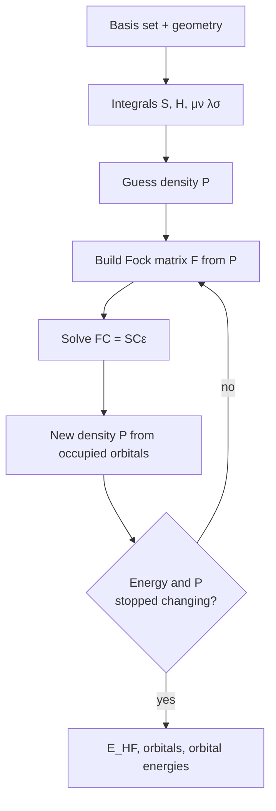

# Hartree–Fock

!!! info "Prerequisites"
    [Potential energy surface](../foundations/potential-energy-surface.md)

Hartree–Fock (HF) is the simplest way to compute a molecule's electrons from
first principles. Its one approximation: each electron moves in the *average*
field of all the others, instead of reacting to where they actually are at
each instant. That makes the problem solvable. HF recovers most of the total
energy (96.5 % for [H₂](app:s/2/0/1), over 99 % for molecules with heavier atoms), and it is the starting point for the more accurate
methods (MP2, coupled cluster) in this project. DFT reuses the same
machinery.

## Idea

### The problem HF solves

For fixed nuclei, the electronic Hamiltonian (atomic units) is

$$
\hat{H} = \underbrace{-\frac{1}{2}\sum_i \nabla_i^2}_\text{kinetic}
\;\underbrace{-\sum_i\sum_A \frac{Z_A}{r_{iA}}}_\text{attraction to nuclei}
\;+\underbrace{\sum_{i<j} \frac{1}{r_{ij}}}_\text{electron repulsion}
$$

The first two terms act on one electron at a time; together they are the
**one-electron operator** $h$. The last term couples every pair of electrons,
and it is the reason the Schrödinger equation $\hat{H}\Psi = E\Psi$ can't be
solved exactly for anything bigger than a one-electron system.

### Step 1: one orbital per electron

HF assumes the wavefunction is built from **orbitals**, one per electron. The
orbitals are combined in a **Slater determinant**, which makes the
wavefunction change sign when two electrons swap. Electrons must behave that
way (they are fermions), and it automatically enforces the Pauli principle.
For two electrons in spin orbitals $\chi_1$ and $\chi_2$:

$$
\Psi(1,2) = \frac{1}{\sqrt{2}}\Big[\chi_1(1)\,\chi_2(2) - \chi_2(1)\,\chi_1(2)\Big]
$$

In **restricted** HF (RHF), electrons are paired: each spatial orbital holds
one spin-up (α) and one spin-down (β) electron. The [H₂](app:s/2/0/1) ground state is one
orbital, $\sigma_g$, holding both electrons.

### Step 2: the mean field

Minimizing the energy of a Slater determinant gives an effective
one-electron equation for each orbital, with the **Fock operator** $f$:

$$
f\,\psi_i = \varepsilon_i\,\psi_i, \qquad
f = h + \sum_{j}^\text{occ} \big(2J_j - K_j\big)
$$

- $J_j$ (**Coulomb**): the classical repulsion from the charge cloud of the electrons in orbital $j$.
- $K_j$ (**exchange**): a correction with no classical analogue, coming from the
  antisymmetry of the determinant. It lowers the repulsion between electrons
  of the same spin, because the determinant keeps them apart.
- $\varepsilon_i$: the **orbital energy**. For an occupied orbital, $-\varepsilon_i$ is
  roughly the energy needed to remove that electron (Koopmans' theorem).

The catch: $f$ depends on the orbitals through $J$ and $K$, and the orbitals
come from $f$. HF is solved by iterating until the orbitals that come out are
the ones that went in: a **self-consistent field** (SCF).

!!! note "No self-interaction"
    In the HF energy, an electron's Coulomb repulsion with its own charge cloud
    is cancelled exactly by its own exchange term. DFT doesn't have this
    exact cancellation, and the leftover **self-interaction error** is why DFT
    gets [H₂⁺](app:s/2/1/2) badly wrong (`doc/Plan.md` §1.2). For a one-electron system HF has
    nothing to approximate, so it is exact within the basis set.

### Step 3: expand in a basis set

Orbitals are unknown functions in 3D space. To make them computable, each is
written as a combination of $N$ fixed **basis functions** $\phi_\mu$ (usually
Gaussians centred on the atoms):

$$
\psi_i = \sum_{\mu=1}^{N} C_{\mu i}\,\phi_\mu
$$

The Fock equation becomes a matrix equation, the **Roothaan–Hall equations**:

$$
\mathbf{F}\mathbf{C} = \mathbf{S}\mathbf{C}\boldsymbol{\varepsilon}
$$

where $S_{\mu\nu} = \langle\phi_\mu|\phi_\nu\rangle$ is the overlap of basis
functions (they aren't orthogonal) and the Fock matrix is built from the
**density matrix** $\mathbf{P}$:

$$
F_{\mu\nu} = H_{\mu\nu} + \sum_{\lambda\sigma} P_{\lambda\sigma}
\Big[(\mu\nu|\sigma\lambda) - \tfrac{1}{2}(\mu\lambda|\sigma\nu)\Big],
\qquad
P_{\lambda\sigma} = 2\sum_a^\text{occ} C_{\lambda a} C_{\sigma a}
$$

$H_{\mu\nu}$ holds the one-electron integrals (kinetic energy and nuclear
attraction). $(\mu\nu|\lambda\sigma)$ are the **two-electron integrals**: the
repulsion between the charge distributions $\phi_\mu\phi_\nu$ and
$\phi_\lambda\phi_\sigma$. There are about $N^4/8$ distinct ones, so computing
them dominates the cost, which grows as $N^4$.

The energy, once converged:

$$
E_\text{HF} = \frac{1}{2}\sum_{\mu\nu} P_{\nu\mu}\big(H_{\mu\nu} + F_{\mu\nu}\big) + V_{NN}
$$

with $V_{NN}$ the nuclear repulsion.

### The SCF loop



Solving $\mathbf{FC} = \mathbf{SC}\boldsymbol{\varepsilon}$ is an ordinary
eigenvalue problem after a change of basis: with $\mathbf{X} =
\mathbf{S}^{-1/2}$, diagonalize $\mathbf{X}^\mathsf{T}\mathbf{F}\mathbf{X}$ and
transform the eigenvectors back with $\mathbf{C} = \mathbf{X}\mathbf{C}'$.

## Example: H₂ from scratch

`wiki/examples/h2_minimal_basis.py` implements all of the above with numpy,
for [H₂](app:s/2/0/1) in the STO-3G basis: one 1s-like function per atom, each a sum of three
Gaussians. The SCF loop is the core:

```python
--8<-- "h2_minimal_basis.py:rhf"
```

Output at the experimental bond length, R = 1.4 bohr:

```text
H2 / STO-3G at R = 1.4 bohr (0.741 Å)

overlap S12 = 0.6593
  iter  1  E_elec = 0.0000000000
  iter  2  E_elec = -1.8309999891
  iter  3  E_elec = -1.8309999891

orbital energies   -0.5782 (sigma_g, occupied)  0.6703 (sigma_u, empty)
nuclear repulsion  0.7143
E(RHF)             -1.1167
E(FCI)             -1.1373
correlation energy -0.0206  (-0.56 eV)
```

These match the values in Szabo & Ostlund, §3.5. Reading the output:

- **Overlap 0.66.** The two atomic functions overlap a lot at this distance:
  that shared region is the chemical bond.
- **Converged right away.** Iteration 1 starts from an empty density, so its
  energy is meaningless. Iteration 3 repeats iteration 2. With only two basis
  functions, symmetry alone fixes the orbitals: $\sigma_g \propto \phi_A +
  \phi_B$ (bonding) and $\sigma_u \propto \phi_A - \phi_B$ (antibonding).
  Bigger problems need more iterations (see the ORCA run below).
- **Orbital energies.** $-\varepsilon_{\sigma_g}$ = 0.578 hartree = 15.7 eV,
  near the measured ionization energy of [H₂](app:s/2/0/1) (15.4 eV).
- **Total energy** = electronic energy + nuclear repulsion = −1.8310 + 0.7143.

### The same thing in ORCA

ORCA's output for a real job from this project ([H₃⁺](app:s/3/1/1) as a triplet, 69 basis functions in
aug-cc-pVTZ, UHF):

```text
               *           SCF CONVERGED AFTER  10 CYCLES          *
TOTAL SCF ENERGY
Total Energy       :         -1.11272506468041 Eh             -30.27879 eV
Components:
Nuclear Repulsion  :          1.01846206783759 Eh              27.71376 eV
Electronic Energy  :         -2.13118713251801 Eh             -57.99255 eV
```

Same structure: a loop that converges, then electronic energy plus nuclear
repulsion. With 69 basis functions there are about 2.8 million distinct
two-electron integrals, against 6 in the toy script, and ORCA needs
convergence accelerators (DIIS) to reach self-consistency in 10 iterations.

## What Hartree–Fock misses

### Correlation energy

Real electrons avoid each other at every instant, not just on average. The
energy HF misses is the **correlation energy**:

$$
E_\text{corr} = E_\text{exact} - E_\text{HF}
$$

It is small compared with the total, but on the scale of chemistry it is
large. For [H₂](app:s/2/0/1) at 1.4 bohr in STO-3G it is −0.0206 hartree (−0.56 eV). In a
complete basis it is −0.041 hartree (−1.1 eV), about a quarter of the bond
energy. Weak binding, like [H₂](app:s/2/0/1) molecules clustering around [H₃⁺](app:s/3/1/1), comes almost
entirely from correlation (dispersion), so HF alone can't describe most of
this project's clusters. MP2 and coupled cluster add correlation on top of
HF.

The ORCA job above shows the other extreme. A triplet has two parallel-spin
electrons, which exchange already keeps apart, so CCSD(T) changes the energy
by only −0.0028 hartree.

### Bond breaking

The [H₂ energy curve](../foundations/potential-energy-surface.md#example-the-h2-curve-computed-two-ways)
shows RHF rising far too high when the bond stretches. The reason is in the
wavefunction. Putting both electrons in $\sigma_g \propto \phi_A + \phi_B$
and multiplying out:

$$
\sigma_g(1)\,\sigma_g(2) \propto
\underbrace{\phi_A(1)\phi_B(2) + \phi_B(1)\phi_A(2)}_\text{covalent: H + H}
+ \underbrace{\phi_A(1)\phi_A(2) + \phi_B(1)\phi_B(2)}_\text{ionic: H⁻ + H⁺}
$$

RHF always mixes the two in equal amounts. Near equilibrium that is
acceptable. At long distance, two neutral atoms should be 100 % covalent, but
RHF stays 50 % [H⁺ + H⁻](app:s/2/0/1), which costs a lot of energy. Full CI fixes this by
mixing in the doubly excited configuration $\sigma_u^2$. Since $\sigma_u
\propto \phi_A - \phi_B$, it contains the same ionic terms but the covalent
terms with the opposite sign, so subtracting it cancels the ionic part.

**Unrestricted HF** (UHF) is the cheaper fix. It lets spin-up and spin-down
electrons have different spatial orbitals, so at long distance one can sit on
each atom. The energy becomes right, but the wavefunction is no longer a
pure singlet (**spin contamination**, measured by ⟨S²⟩).

## Where this appears in [h_clusters](https://github.com/skachano/h_clusters)

- **Restricted vs unrestricted.** `worker/src/hclust/engines/orca.py` adds `UHF`
  (or `UKS` for DFT) to every input with multiplicity > 1. Closed-shell
  singlets get ORCA's default, RHF. `TightSCF` tightens the convergence
  thresholds of the loop above.
- **One-electron species.** H and [H₂⁺](app:s/2/1/2) have no electron pairs to correlate.
  Levels marked `correlated` in `worker/src/hclust/levels.py` (MP2, CCSD(T))
  fall back to plain HF for them, which is exact within the basis.
- **Reference for correlated methods.** L1M (RI-MP2) and L2 (CCSD(T)) both run
  an HF calculation first and add correlation to it.
- **Stretched singlets.** `doc/Plan.md` §2 suggests a broken-symmetry guess
  (`%scf GuessMix`) for singlets with stretched H–H contacts, the bond-breaking
  case above.
- **Self-interaction.** The DFT levels have the self-interaction error that HF
  avoids. That is the reason for the MP2 geometry level L1M (see its comment in
  `levels.py`).

## References

- A. Szabo, N. S. Ostlund, *Modern Quantum Chemistry*, chapter 3 (the
  Hartree–Fock approximation; §3.5 has the [H₂](app:s/2/0/1) calculation reproduced here).
- F. Jensen, *Introduction to Computational Chemistry*, 3rd ed., chapter on
  Hartree–Fock theory.
- W. J. Hehre, R. F. Stewart, J. A. Pople, *J. Chem. Phys.* **51**, 2657 (1969):
  the STO-3G basis set.
