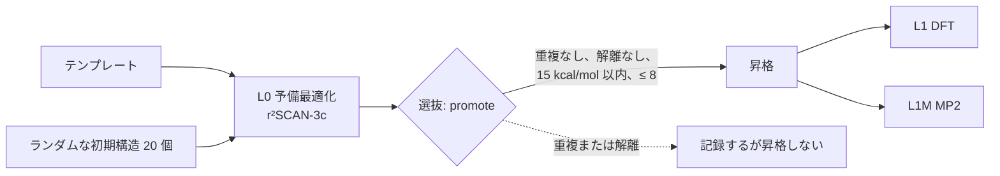

# 大域的構造探索

!!! info "前提知識"
    [ポテンシャルエネルギー曲面](../foundations/potential-energy-surface.md)、[構造最適化](geometry-optimization.md)

[構造最適化](geometry-optimization.md)は最も近い極小まで坂を転がり落ちるだけである。*最も低い*極小や、他の低い異性体を見つけるには、多くの異なる場所から出発しなければならない。[H₁₀](app:s/10/0/1) のような 24 次元の曲面ではすべてを試すことはできないので、大域探索は知識に基づく推測、ランダムさ、記録管理を組み合わせる。このプロジェクトではどのクラスターも形が分かっていないので、この探索がすべての計算の第一段階になる。

## 考え方

### なぜ難しいのか

PES 上の極小の数は、原子数とともにおおよそ指数関数的に増える。大域的極小のほうを指す勾配はなく、今いる谷の底を指す勾配しかない。どんな探索でも答えを見逃し得るし、探索の結果は出発点の質を超えない。

### 戦略

| 戦略 | 方法 | 強み |
|---|---|---|
| **テンプレート** | 化学的直観による手づくりの構造: 鎖、環、多面体、既知のモチーフ | 予想される構造を安く見つける |
| **ランダムな出発点** | 多数のランダムな構造を、それぞれ最適化する | 予想外のものを見つける。偏りがない |
| **ベイスンホッピング、遺伝的アルゴリズム** | よい構造を摂動したり組み合わせたりし、改善を残す | 大きなクラスターで効率的 |
| **メタダイナミクス** (例: ORCA の GOAT) | バイアスポテンシャルで、訪れた谷から系を押し出す | 系統的に探索する |

安価な手法ですべての候補を選別し、上位の少数だけを高価なレベルで精密化する。これは、安価な手法がおおよそ正しく順位づけできる場合にしかうまくいかず、それは保証されていない ([xTB](../methods/xtb.md)、[H₅⁺](app:s/5/1/1) での [DFT](../methods/dft.md))。

### 重複

異なる出発点が、回転したり、平行移動したり、原子の番号が入れ替わったりした同じ極小に行き着くことはよくある。座標を直接比べてもうまくいかず、この 3 つをすべて無視する**指紋**が必要である。一種類の元素からなるクラスターで最も単純なのは、すべての原子間距離を並べ替えたリストである。

## このプロジェクトのやり方 { #how-this-project-does-it }



**初期構造** (`worker/src/hclust/structures.py`):

- テンプレート: `chain` (鎖)、`ring` (環)、`sphere` (球面上に散らばった点、コンパクトな多面体)、`h2_units` ((H₂)ₖ の配置)、`h3_core` (H₂ ユニットに囲まれた [H₃⁺](app:s/3/1/1) の三角形。H₅⁺、[H₇⁺](app:s/7/1/1)、[H₉⁺](app:s/9/1/1) で予想されるモチーフ)。
- ランダム: 半径 0.8·m^(1/3) + 0.4 Å の球の中に原子を一様に置く。どの 2 原子も 0.6 Å より近づけず、どの原子も他の原子から 1.6 Å 以内に置くので、出発構造が最初からばらばらになっていることはない。乱数生成器は明示的なシードを受け取るので、同じキャンペーンを 2 回計画すると同じ構造、したがって同じジョブができる ([ジョブのハッシュ化](../htc/job-hashing.md))。

**指紋と重複。**最適化された 2 つの構造は、エネルギーの差が 0.1 kcal/mol 未満、*かつ*指紋の RMS 差が 0.05 Å 未満なら同じとみなす:

```python
def fingerprint(geometry: Geometry) -> np.ndarray:
    """Sorted interatomic distances: invariant to translation, rotation and atom permutation."""
    return geometry.distances()
```

**解離した構造。**最適化の途中でばらばらになる出発点もある。3.5 Å より短い接触がない複数の部分に分かれた構造は、解離したとみなす。それは結果として記録され、再試行も昇格もされない。カットオフは最初 2.5 Å だったが、それでは本物の複合体を捨ててしまうことが分かった。H⁻·H₂ には 2.84 Å の接触があり、H₂·H₂ は約 3.3 Å である (フェーズ 4 の知見)。結合したユニット (1.15 Å 未満の接触) から、各構造に `H3·H2·H2` のような**組成**ラベルがつく。

### ベースライン探索で見つかったもの

ベースラインキャンペーンの `candidate` テーブルより (執筆時点):

| promote ステージ | 数 |
|---|---|
| 予備最適化された構造 | 1016 |
| 解離 | 120 |
| 重複 | 574 |
| L1 と L1M へ昇格 | 202 |

出発点の半分以上が重複に終わる。小さな水素クラスターの地形には極小が少なく、多くの道が同じところへ通じている。各状態の最低エネルギー構造のうち、31 個はランダムな出発点から、14 個はテンプレートから来た。どちらの出どころも必要である。

H₃⁺ では、20 個のランダムな出発点すべてが三角形を見つけた (フェーズ 3)。H₅⁺ では L0 ですべての出発点が D₂d 構造に行き着いた。選別レベルの DFT に C₂ᵥ 極小がないからである。MP2 の分岐が C₂ᵥ を取り戻せたのは、その最適化と鞍点からのずらしがそれらの構造をそこへ動かしたからにすぎない。探索は選別手法の死角を受け継ぐ。

## h_clusters での登場箇所

- `campaigns/baseline.yaml` の `seeds:` と、`pre` / `promote` ステージ。
- `worker/src/hclust/structures.py` の `GENERATORS`、`fingerprint`、`same_structure`、`is_dissociated`、`composition`。選抜の処理は `worker/src/hclust/runner.py` の `Runner._select` である。
- すべての判断 (順位、重複先、解離、組成、出どころ) は `candidate` テーブルに保存され、`python -m hclust structures <campaign> --stage <name>` で一覧できる。
- xTB を使った ORCA の GOAT-EXPLORE は初期構造の出どころとして使えるが、フェーズ 3 では生き残る構造を何も加えず、ベースラインでは無効にしている。
- ウェブアプリ: 各状態で残った異性体は、その化学種ページにある。例: [H₅⁺](app:s/5/1/1)。

## 参考文献

- D. J. Wales, *Energy Landscapes* (Cambridge, 2003)。
- B. de Souza, *Angew. Chem. Int. Ed.* (2025): ORCA 6 の大域最適化法 GOAT。
