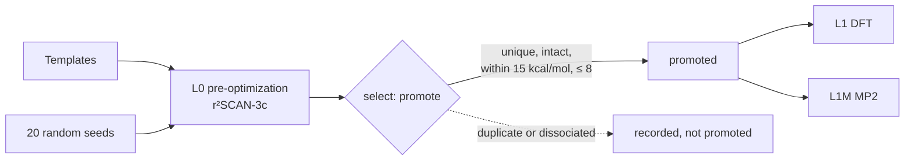

# Global structure search

!!! info "Prerequisites"
    [Potential energy surface](../foundations/potential-energy-surface.md),
    [Geometry optimization](geometry-optimization.md)

A [geometry optimization](geometry-optimization.md) only rolls downhill to
the nearest minimum. To find the *lowest* minimum, and the other low-lying
isomers, you have to start from many different places. For a 24-dimensional
surface like [H₁₀](app:s/10/0/1)'s there is no way to try everything, so a global search
combines educated guesses, randomness and bookkeeping. In this project the
shape of every cluster is unknown, so this search is the first stage of every
calculation.

## Idea

### Why it's hard

The number of minima on a PES grows roughly exponentially with the number of
atoms. There's no gradient that points towards the global minimum, only
towards the bottom of the current valley. Any search can miss the answer,
and a search's result is only as good as its starting points.

### Strategies

| Strategy | How | Strength |
|---|---|---|
| **Templates** | Hand-built structures from chemical intuition: chains, rings, polyhedra, known motifs | Finds the expected structures cheaply |
| **Random starts** | Many random geometries, each optimized | Finds the unexpected; no bias |
| **Basin hopping, genetic algorithms** | Perturb or combine good structures, keep improvements | Efficient for large clusters |
| **Metadynamics** (e.g. ORCA's GOAT) | Push the system out of visited valleys with a bias potential | Explores systematically |

A cheap method screens all candidates; only the best few are refined at
expensive levels. This only works if the cheap method ranks structures
roughly right, which isn't guaranteed ([xTB](../methods/xtb.md),
[DFT](../methods/dft.md) for [H₅⁺](app:s/5/1/1)).

### Duplicates

Different starts often end in the same minimum, possibly rotated, shifted or
with atoms numbered differently. Comparing coordinates directly fails; a
**fingerprint** that ignores all three is needed. The simplest for clusters
of one element: the sorted list of all interatomic distances.

## How this project does it



**Seeds** (`worker/src/hclust/structures.py`):

- Templates: `chain`, `ring`, `sphere` (points spread over a sphere, a
  compact polyhedron), `h2_units` ((H₂)ₖ arrangements) and `h3_core` (an [H₃⁺](app:s/3/1/1)
  triangle surrounded by [H₂](app:s/2/0/1) units, the expected motif of [H₅⁺](app:s/5/1/1), [H₇⁺](app:s/7/1/1), [H₉⁺](app:s/9/1/1)).
- Random: atoms placed uniformly in a ball of radius 0.8·m^(1/3) + 0.4 Å,
  no two closer than 0.6 Å, and every atom within 1.6 Å of another so the
  start isn't already in pieces. The random generator takes an explicit seed,
  so planning a campaign twice gives the same structures and therefore the
  same jobs ([job hashing](../htc/job-hashing.md)).

**Fingerprint and duplicates.** Two optimized structures are the same if
their energies differ by less than 0.1 kcal/mol *and* the RMS difference of
their fingerprints is below 0.05 Å:

```python
def fingerprint(geometry: Geometry) -> np.ndarray:
    """Sorted interatomic distances: invariant to translation, rotation and atom permutation."""
    return geometry.distances()
```

**Dissociated structures.** Some starts fall apart during optimization.
A structure counts as dissociated if it splits into pieces with no contact
shorter than 3.5 Å. That is recorded as a result, never retried and never
promoted. The cutoff started at 2.5 Å, which turned out to discard real
complexes: [H⁻·H₂](app:s/3/-1/1) has a 2.84 Å contact, [H₂·H₂](app:s/4/0/1) about 3.3 Å (Phase 4 findings).
Bonded units (contacts under 1.15 Å) give each structure a **composition**
label such as `H3·H2·H2`.

### What the baseline search found

From the `candidate` table of the baseline campaign, at the time of writing:

| Promote stage | Count |
|---|---|
| Pre-optimized structures | 1016 |
| Dissociated | 120 |
| Duplicates | 574 |
| Promoted to L1 and L1M | 202 |

More than half of all starts end as duplicates: the landscapes of small
hydrogen clusters have few minima, and many roads lead to each. Of the
lowest-energy structures per state, 31 came from random starts and 14 from
templates. Both sources are needed.

For [H₃⁺](app:s/3/1/1), all 20 random starts found the triangle (Phase 3). For [H₅⁺](app:s/5/1/1) every
start ended in the D₂d structure at L0, because the screening level's DFT
has no C₂ᵥ minimum. The MP2 branch recovered C₂ᵥ from those structures only
because its optimizer, and the saddle-point displacement, moved them there.
A search inherits the blind spots of its screening method.

## Where this appears in h_clusters

- `seeds:` and the `pre` / `promote` stages in `campaigns/baseline.yaml`.
- `GENERATORS`, `fingerprint`, `same_structure`, `is_dissociated` and
  `composition` in `worker/src/hclust/structures.py`; the selection logic is
  `Runner._select` in `worker/src/hclust/runner.py`.
- Every decision (rank, duplicate-of, dissociated, composition, source) is
  stored in the `candidate` table; `python -m hclust structures <campaign>
  --stage <name>` lists it.
- ORCA's GOAT-EXPLORE with xTB is available as a seed source, but added no
  surviving structure in Phase 3 and is off in the baseline.
- Web app: the isomers kept for each state are on its species page, e.g.
  [H₅⁺](app:s/5/1/1).

## References

- D. J. Wales, *Energy Landscapes* (Cambridge, 2003).
- B. de Souza, *Angew. Chem. Int. Ed.* (2025): GOAT, the global optimizer in
  ORCA 6.
